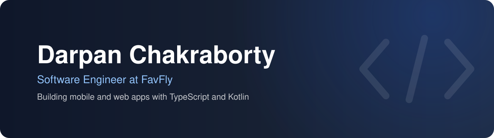

  

 

## 👋 About me

- 🛠️ Software Engineer at **FavFly**
- 📱 I build small Android tools that fix everyday annoyances
- 🐝 Now building **Hive**, a chat-first expense splitter (Expo + Firebase)
- 🌐 More at [dcoder.me](https://dcoder.me)

## 🧰 Tech I use

  

## 🚀 Featured projects

<table>
  <tr>
    <td width="33%" valign="top">
      
      <h3><a href="https://github.com/dcoder-me/onebuds">OneBuds</a></h3>
      
Realme Buds T310 battery and noise control: Live Update, widgets, Quick Settings tile. No internet permission.

      Kotlin · Jetpack Compose · Android 14+
    </td>
    <td width="33%" valign="top">
      
      <h3><a href="https://github.com/dcoder-me/wifi-switcher">WiFi Switcher</a></h3>
      
Switches between Wi-Fi and mobile hotspot on its own. Works with Shizuku or root.

      Kotlin · Android 8.0+
    </td>
    <td width="33%" valign="top">
      
      <h3><a href="https://github.com/dcoder-me/hive.ai">Hive</a></h3>
      
A group chat that does the math: chat your expenses, AI splits who owes what.

      TypeScript · Expo · Firebase · In development
    </td>
  </tr>
</table>

  Thanks for stopping by.

